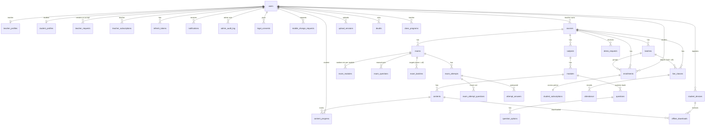

# Entity Relationship Diagram

Migrations: `001_core`, `002_content`, `003_exams`, `004_operations`, `005_student`. All keys are `INT IDENTITY` unless noted, and all times are UTC `DATETIME2(3)`.

| Migration | Tables |
|---|---|
| 001_core | users, teacher_profiles, student_profiles, teacher_requests, teacher_subscriptions, otp_codes, refresh_tokens, notifications, admin_audit_log, legal_consents, mobile_change_requests |
| 002_content | courses, subjects, modules, contents, batches, upload_sessions |
| 003_exams | questions, question_options, exams, exam_modules, exam_questions, exam_batches, exam_attempts, exam_attempt_questions, attempt_answers |
| 004_operations | demo_requests, enrollments, student_subscriptions, live_classes, attendance, doubts, class_programs |
| 005_student | content_progress, student_devices, offline_downloads |

Key rules:
- `users.mobile` is unique only among non-deleted users (`deleted_at IS NULL`).
- Teacher-owned data is always queried with `teacher_id = @me`.
- Questions used in an exam are archived (`is_archived`, `replaced_by`), never deleted.
- `admin_audit_log` is append-only.
